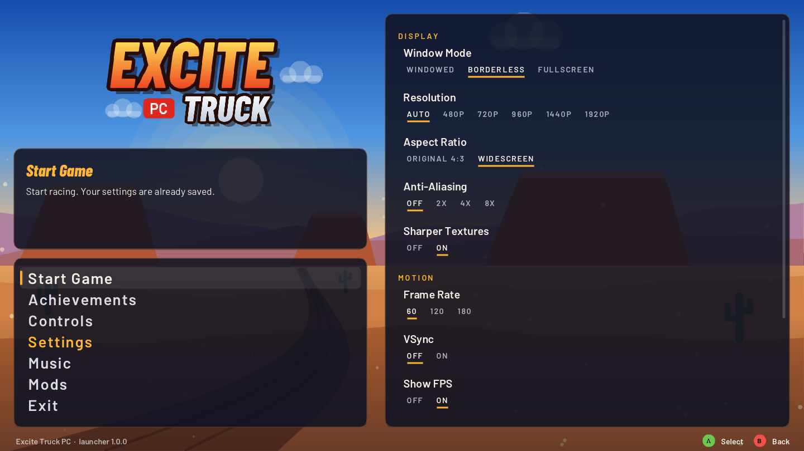

# Excite Truck PC

A native PC remaster of **Excite Truck** (Wii, 2006), built with static recompilation.
The game's PowerPC code is translated to C++ ahead of time and compiled into a normal PC program,
with no emulator in the loop.

Goals: 120 fps, HD and widescreen, longer draw distance, RetroAchievements, Xbox controller
layout (R/R2 drive, X brake, A turbo, left stick for steering and air control), and later
online two-player.

> No game code, assets or disc images are in this repository. You need your own dump of the
> US disc (`REXE01`, revision 0). The translation runs on your machine against that dump.

## Status

Step 1 of 4 (taking the game apart) is done. See [docs/step1-findings.md](docs/step1-findings.md).
Step 2 (running on PC) is under way: menus, the attract demo, the tutorial and full Excite races
play, with the trucks in their proper colours. Every shader is compiled on the startup screen, so
races don't stutter. See
[docs/porting-notes.md](docs/porting-notes.md).

## Controls

Xbox-style gamepad, in a race: RT or RB drive, X, LT or LB brake, A turbo, left stick steers and tilts the
truck in the air. Air control is inverted by default (push up to dip the nose); turn that off with
"Invert air control" in the F10 settings bar under Controllers. A also presses the "2" button, so
it answers the "press 2" boost after a crash, even while R is held. Y (and Select/View in a race) is the Wii A button.

In menus and the pause menu: A selects, B goes back, and the left stick or D-pad moves.

New profiles skip the tutorial that the game normally forces; it is still in the main menu.

The game opens borderless full screen at your monitor's resolution (1080p on a 1080p screen).
Alt+Enter switches to a window; F10 has the display and resolution settings.

## Graphics options (F10, Graphics)

- **Frame interpolation**: 120 or 180 FPS. The game still runs at 60; an in-between frame is drawn
  from the last two. Turn VSync on and use a 120 Hz (or faster) screen. Config key:
  `[video] frame_interpolation_fps` (0, 120, 180).
- **Draw distance**: Original, 1.5x, 2x or 3x. Pushes the race fog and the far clip out so you see
  further. Config key: `[excite_truck] draw_distance` (1.0 to 4.0).
- **Sharper textures at angles**: 16x anisotropic filtering, on by default. Config key:
  `[video] anisotropic_filtering` (true/false). Applies after a restart.
- **Anti-aliasing (MSAA)**: Off, 2x, 4x, 8x. Off by default since it costs GPU time. Config key:
  `[video] msaa` (1, 2, 4, 8). Applies after a restart.

## Launcher

`ExciteTruckLauncher` opens first (the desktop shortcut points at it). It has the same layout as
the [1080° Snowboarding launcher](https://github.com/thebradshaw/1080-Snowboarding-decomp): the
main menu at the bottom left, a help box that explains whatever is under the cursor, and the
current page on the right.



- **Start Game** starts `ExciteTruck` and closes the launcher.
- **Settings**: window mode, resolution, aspect ratio, graphics API (Windows), anti-aliasing,
  sharper textures, frame rate (60, 120 or 180), VSync, the FPS counter, draw distance and volume.
- **Controls**: the Xbox layout, air control (flight style or direct) and vibration.
- **Music**: where your MP3s go, the songs found there, buttons to open the folder or pick another
  one, and you can drop MP3s on the window to copy them in.
- **Mods**: Dolphin-format texture packs on or off, and their folder.
- **Achievements**: the achievements you have unlocked, with points and dates. The game saves them on your PC in `UserData/achievements/` (`definitions.json` lists them, `unlocks.json` records what you have earned). Online RetroAchievements sign-in is planned for later.

Everything is saved straight to the game's `Config.toml`, so the F10 bar in the game shows the
same values. Mouse, keyboard (arrows, Enter, Esc) and controllers (D-pad or left stick, A, B) all
work. The launcher's code is in `launcher/`; the build scripts compile it next to the game.

## Your own music

Drop MP3s into `ExciteTruck/UserData/Music` (the build scripts create it), or choose another
folder on the launcher's Music page. Subfolders are fine, up to 100 songs. In the game, set
Options > Race Music to All Random and your songs play during races, as with an SD card on the Wii.

## Layout

| Path | What it is |
| --- | --- |
| `third_party/wiicompiled` | The [WiiCompiled](https://github.com/patchzyy/Wiicompiled) recompiler and runtime (GPLv3), pinned |
| `projects/excite-truck/recomp.yml` | Translator manifest for the US disc |
| `projects/excite-truck/MAP.txt` | Function start addresses that seed the translator |
| `tools/` | Small Python helpers for reading the game's `main.dol` |
| `scripts/translate.sh` | Runs the translation |
| `launcher/` | The launcher (SDL3 + Dear ImGui, Barlow fonts under the SIL Open Font License) |

## Building and playing

You need your own copy of the US disc (REXE01) as a .wbfs, .iso or .rvz image (a .zip holding
one works on Windows). The scripts check the disc, fetch the pinned WiiCompiled sources, apply this
repo's patches, translate the game's code to C++, compile it and put the game in `ExciteTruck/`.
The first build takes a while (mostly compiling); nothing from the disc ends up in this repo.

**Windows 10/11, easiest:** drag your disc image onto `ExciteTruckSetup.exe`. It needs nothing
installed, builds the game into `%LOCALAPPDATA%\Programs\ExciteTruck` and puts "Excite Truck" and
"Excite Truck Music" shortcuts on the desktop. Windows may warn that the exe is unrecognised (it
isn't signed): click More info, then Run anyway. `scripts/make-setup.sh` builds the exe.

**Windows 10/11, from a checkout** (needs [Git for Windows](https://git-scm.com/download/win), for example
`winget install Git.Git`; the compiler, CMake, Ninja, .NET and libraries are downloaded with
pinned checksums):

```powershell
git clone https://github.com/thebradshaw/excite-truck-pc.git
cd excite-truck-pc
powershell -ExecutionPolicy Bypass -File scripts\build-windows.ps1 "D:\Games\Excite Truck (USA).wbfs"
```

Then run `ExciteTruck\ExciteTruckLauncher.exe` (or `ExciteTruck.exe` to skip the launcher). Build files go to `C:\ETBuild` (about 20 GB, safe to
delete afterwards; `-Work` picks another folder).

**Linux** (Debian/Ubuntu: `sudo apt install git cmake ninja-build clang python3 curl dotnet-sdk-8.0`):

```sh
scripts/build-linux.sh "/path/to/Excite Truck (USA).wbfs"
./ExciteTruck/ExciteTruckLauncher
```

The game folder is portable: settings, saves and caches live in `ExciteTruck/UserData`, and your
songs go in `ExciteTruck/UserData/Music`. Running the script again after `git pull` rebuilds only
what changed.

## License

GPLv3, matching WiiCompiled.
